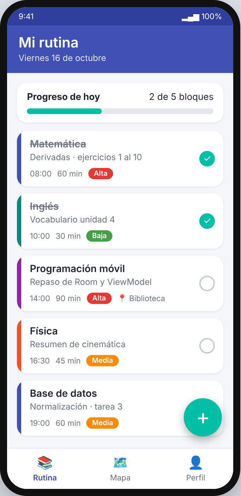
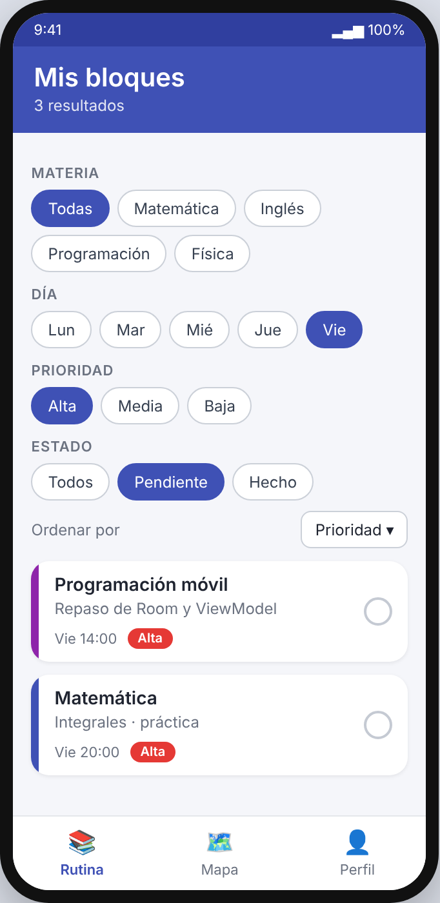
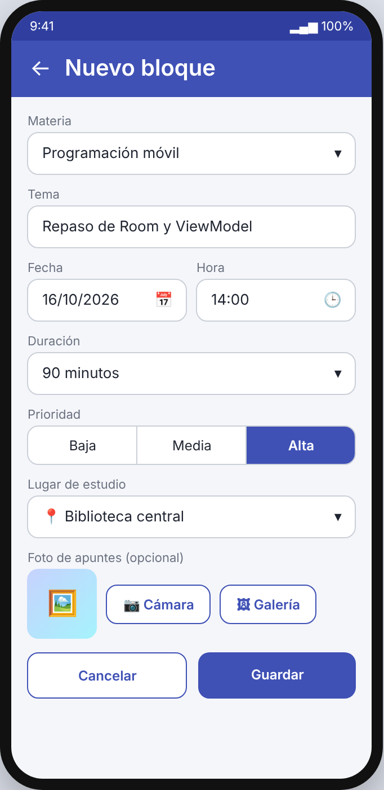
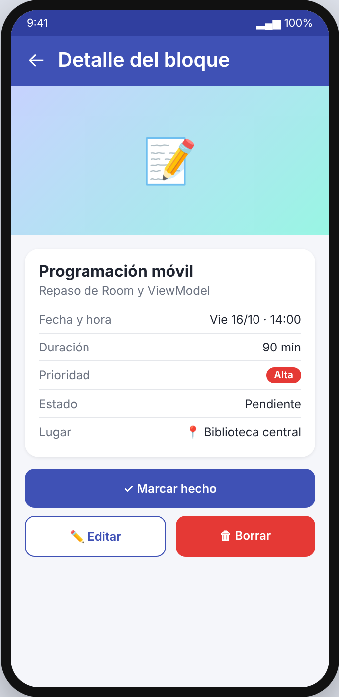
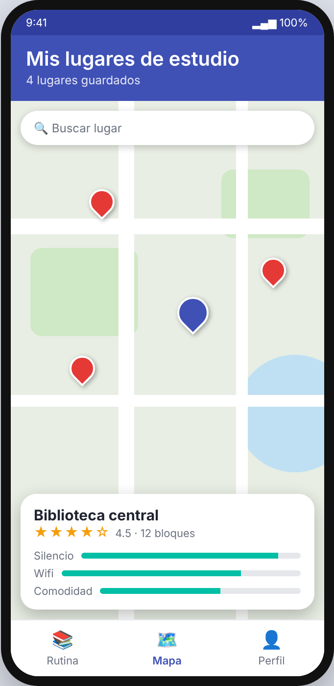
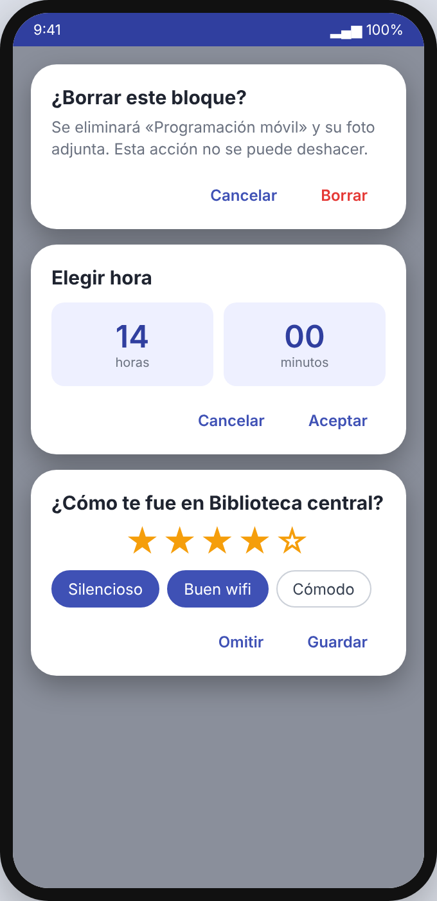

# YozStudy

**Planificador de rutinas de estudio con mapa de lugares donde mejor rendís.**

## Descripción de la idea

YozStudy es una aplicación móvil Android que ayuda a estudiantes a organizar su rutina de estudio en bloques por materia, con duración, prioridad y estado. Además de planificar el tiempo, permite registrar dónde se estudia (biblioteca, café, casa, universidad) y calificar cada lugar según su ambiente (silencio, wifi, comodidad), de modo que la persona descubra en qué lugares rinde más. También permite adjuntar fotos de apuntes o de la pizarra a cada bloque de estudio.

**Problemática que resuelve:** muchos estudiantes no tienen una idea clara sobre qué rutina de estudio y qué condiciones les convienen para un mejor aprendizaje. La aplicación les da un plan visible, filtrable y con evidencia de sus avances.

**Público objetivo:** estudiantes de colegio, universidad o autodidactas.

## Integrantes

| Nombre | Rol |
|---|---|
| [Nombre completo] | [Rol / módulo] |

## Funcionalidades

| Requisito | Cómo se cumple en YozStudy |
|---|---|
| **CRUD** | Crear, ver, editar y borrar bloques de estudio (materia, tema, duración, prioridad, día, estado) y lugares de estudio. |
| **Lista con filtros personalizados** | Filtrar los bloques por materia, día de la semana, prioridad y estado (pendiente / hecho). Ordenar por fecha o prioridad. |
| **Acceso a cámara o galería** | Adjuntar a cada bloque una foto de apuntes, pizarra o material, tomada con la cámara o elegida de la galería. |
| **Dialog** | Confirmación al borrar un bloque, selector de fecha y hora, y diálogo para calificar el lugar al terminar de estudiar. |
| **Mapa** | Mapa con los lugares de estudio guardados como marcadores; al tocar uno se ve su calificación y los bloques realizados allí. |

## Pantallas y mockups

## Pantallas y mockups

### 1. Inicio / Mi rutina
Lista de bloques de estudio del día con barra de progreso y botón flotante para agregar.



### 2. Lista con filtros
Chips de filtro (materia, día, prioridad, estado) y ordenamiento.



### 3. Crear / editar bloque
Formulario con materia, tema, duración, prioridad, lugar y foto adjunta (cámara o galería).



### 4. Detalle del bloque
Información completa, foto adjunta, lugar y botones de editar y borrar.



### 5. Mapa de lugares
Marcadores de lugares de estudio con su calificación.



### 6. Diálogos
Confirmar borrado, elegir hora y calificar el lugar.



### Buenas prácticas de UX consideradas

- Navegación simple con barra inferior (Rutina, Mapa, Perfil).
- Un solo botón de acción principal por pantalla.
- Confirmación antes de acciones destructivas.
- Estados vacíos con mensaje claro ("Aún no tenés bloques de estudio").
- Colores y tamaños de texto con buen contraste y legibilidad.
- Retroalimentación visual al completar un bloque (progreso del día).

## Tecnologías

- **Lenguaje:** Kotlin / Java
- **IDE:** Android Studio
- **Base de datos local:** Room (SQLite)
- **Mapas:** Google Maps SDK / OSMdroid
- **Cámara y galería:** ActivityResult API / CameraX
- **Arquitectura:** MVVM

## Estructura del repositorio

```
YozStudy/
├── app/                # Código fuente de la aplicación Android
├── docs/
│   └── mockups/        # Imágenes de los mockups
└── README.md
```

## Flujo de trabajo en GitHub

- La rama `main` está protegida: no se permiten commits ni push directos.
- Cada avance semanal se desarrolla en una rama propia (por ejemplo `feature/lista-filtros`).
- Los cambios llegan a `main` únicamente por Pull Request, con una revisión (code review) del profesor antes de hacer el merge.

